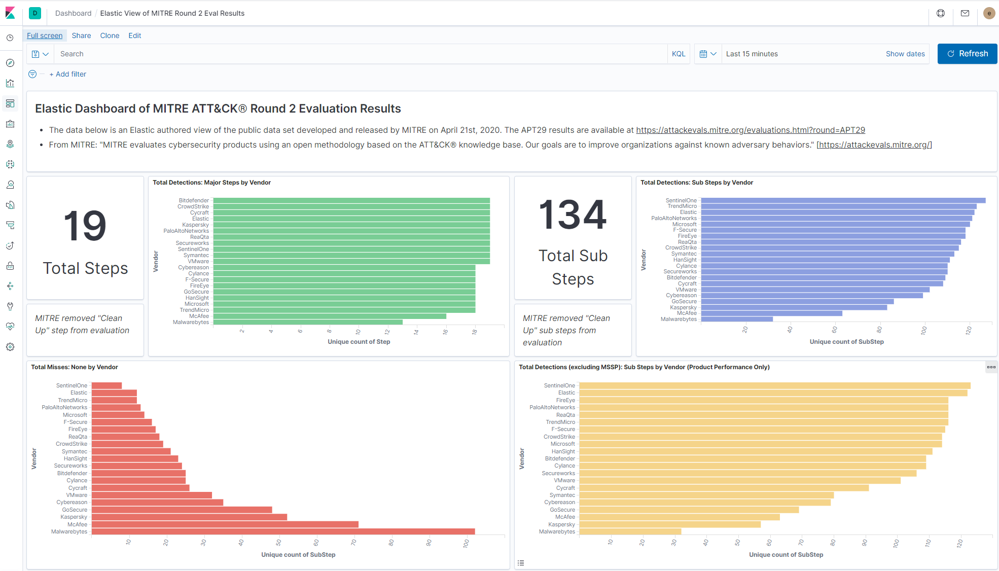
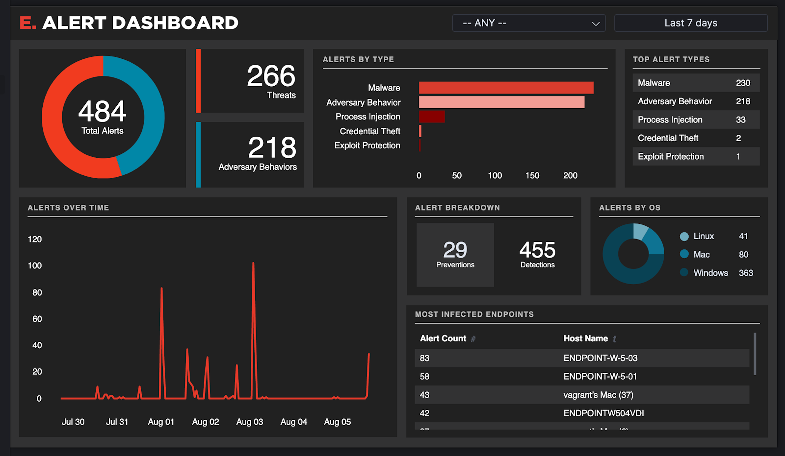
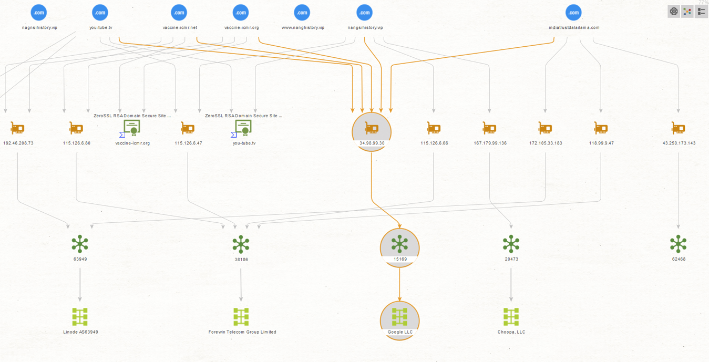

# ⚙️ Threat Actor TTP Tracking Dashboard

> This project is a threat actor tracking system that integrates MITRE ATT&CK mappings, open threat intelligence feeds, and visualization tools like Elastic and Maltego. It allows analysts to monitor, map, and report on adversary behaviors (e.g., APT29, FIN6) using real-world TTPs, log correlations, and graph-based infrastructure analysis. Each component of the dashboard contributes to a full-cycle CTI workflow — from data ingestion to visual analysis and reporting.

## 🛠 Tools Used
- MITRE ATT&CK Navigator
- Elastic Stack (Kibana + Elasticsearch)
- Maltego

---

## 🎯 Objectives

- Track known threat actors (e.g., FIN6, APT29)
- Visualize their MITRE techniques using ATT&CK Navigator
- Collect and ingest open threat intel (STIX, CSV, MISP)
- Use Maltego to visualize infrastructure and relationships

---

## 📂 Folder Structure & Quick Links

| Folder      | Purpose                                      | Example Files |
|-------------|----------------------------------------------|---------------|
| [`feeds/`](./feeds)     | Raw STIX, MISP, CSV threat intel feeds     | `.gitkeep` placeholder |
| [`mapping/`](./mapping) | MITRE ATT&CK `.layer.json` files for actors | [APT29.layer.json](./mapping/APT29.layer.json) |
| [`visuals/`](./visuals) | Screenshots of dashboards, Navigator, Maltego | `.gitkeep` placeholder |
| [`reports/`](./reports) | IOC reports, actor TTP summaries           | [APT29.md](./reports/apt29.md) |
| [`scripts/`](./scripts) | Scripts for data enrichment/ingestion     | `.gitkeep` placeholder |

---

## 🧪 Dashboard Workflow

1. **Feed Collection**:
   - Source open threat intel from AlienVault OTX, MISP, or MITRE
   - Save STIX/CSV in [`feeds/`](./feeds)

2. **TTP Mapping**:
   - Use ATT&CK Navigator to create a `.layer.json` for actors
   - Save in [`mapping/`](./mapping)

3. **Elastic Dashboards**:
   - Ingest logs or IOCs into Elasticsearch
   - Visualize with Kibana → Save screenshots to [`visuals/`](./visuals)
   - 
   - 

4. **Relationship Mapping**:
   - Use Maltego to map infrastructure and threat actor overlap
   - 

